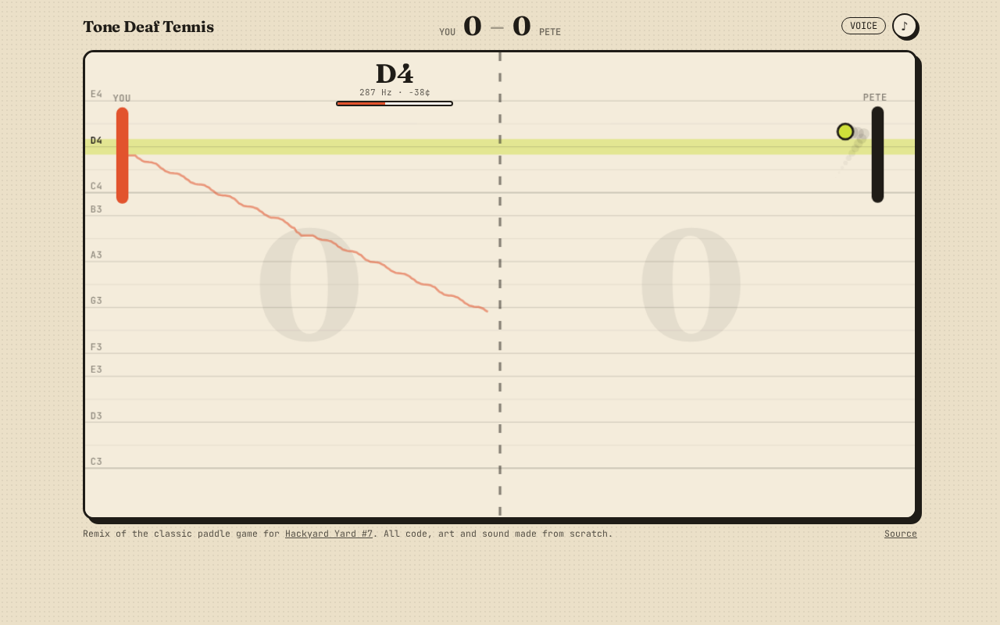

# Tone Deaf Tennis

**The classic two-paddle game, except you play it by humming.**

High note, paddle goes up. Low note, paddle goes down. Go quiet and it slowly sinks. Belt it as the ball arrives and your return becomes a smash. Your opponent is Perfect Pitch Pete, who only ever plays a perfectly tuned C and has opinions about your B.

**Play it:** https://tone-deaf-tennis.thethomas.tech (no sign-up, nothing to install, audio never leaves your browser)



## The remix

Built for [Hackyard Yard #7: Remix](https://hackyard.tech/yards/yard-7).

- **What it remixes:** the 1972 arcade paddle game everyone knows. Two paddles, a ball, a dashed net, first to 7.
- **What stays:** the court, the physics, the rally, the score.
- **The one big change:** what powers it. There are no keys and no knob. Your paddle is your voice. The game listens to the microphone, works out the note you are humming about 60 times a second, and puts your paddle there.

Everything else follows from that one change:

- **The court is a stave.** Before you play, you hum your lowest and highest comfortable notes. The court is then drawn as one line per semitone in *your* range, labelled C3, D3 and so on, and the note you are humming lights up. You can see exactly why the paddle is where it is.
- **Rallies become songs.** Every return plays back the note you were humming when you hit it. At the end you can play your whole match back as a tune (it is usually bad).
- **Loudness is a move.** Belting as the ball arrives makes a smash: 40% faster.
- **Silence has consequences.** Stop humming and the paddle sinks.
- **A certificate.** After the match you get a downloadable certificate with your range, hum time, longest rally, smashes, the tune you played, and a scientific verdict from *Monotone Menace* to *Whale Song Enjoyer*.

Two other ways in, so nobody bounces off:

- **Watch the robot hum.** A synthetic hummer plays for you. Its hum is fed through the *same* pitch detector your voice would go through, so it is a live demo of the real pipeline, not a scripted animation.
- **Coward mode.** Mouse or arrow keys, Shift to smash. Your certificate will say "Certified Coward".

## How it works

| Part | What it does |
| --- | --- |
| `src/pitch.ts` | A from-scratch [YIN](http://audition.ens.fr/adc/pdf/2002_JASA_YIN.pdf) pitch detector (difference function, cumulative mean normalisation, threshold, parabolic interpolation), plus note naming and the pitch to court mapping. Pure functions, no DOM. |
| `src/game.ts` | Court physics and Pete. Deterministic with a seeded RNG, so whole matches can be simulated in tests. |
| `src/audio.ts` | Microphone input (echo cancellation and auto gain off, so your pitch isn't mangled), the robot hummer, and all sound effects, synthesised with Web Audio. |
| `src/main.ts` | Calibration, the game loop (fixed 120 Hz physics step), drawing, screens. |
| `src/certificate.ts` | Draws the end-of-match certificate PNG. |

Details that matter when you are playing with your voice:

- Pitch is mapped in **semitones, not Hz**, so the middle of the court is the middle of your range as you hear it.
- A short **median filter** stops the odd octave jump from teleporting your paddle.
- Your own **sound effects are ignored** by the mic while they play, so a beep can't steer you. (Headphones help anyway.)
- Gaps of under 140 ms between syllables don't count as silence.

No frameworks. TypeScript, Canvas 2D and Web Audio, built with Vite. Fonts (Fraunces, JetBrains Mono) are bundled, so the game makes no third-party requests.

## Testing

```bash
npm install
npm test          # 45 unit tests: pitch detection and game physics
npm run test:e2e  # 4 browser tests with Playwright
```

What the tests prove, in numbers:

- **Pitch detection:** pure tones from 82 Hz (E2) to 880 Hz (A5) are found within **5 cents**. Buzzy, hum-like tones with 6 harmonics within **10 cents**. With background noise at about 10 dB SNR, at least **90%** of frames still land within 25 cents. Silence and white noise return nothing, rather than a random note.
- **Physics:** a perfect hummer never concedes a point in 60 s; a silent player loses 0–7; a perfect hummer who angles their shots beats Pete in at least 15 of 20 seeded matches within 5 minutes (so Pete is beatable, just smug); belting makes a return at least 30% faster; the ball never leaves the court or breaks the speed cap.
- **End to end, in Chromium:** a recorded hum (`tests/fixtures/hum.wav`: 3 s of C3, 3 s of E4, then glides) is fed in as the microphone. Calibration lands on **130.5 Hz and 329.9 Hz** for notes that are really 130.8 Hz and 329.6 Hz, and the glide moves the paddle about **400 px** across the court. The robot demo rallies with Pete through the real detector, and coward mode plays a full match to the certificate.

## Run it locally

```bash
npm install
npm run dev
```

Then open the printed URL and allow the microphone. A quiet room and headphones work best.

## Honest notes

- All code, art and sound in this repo were written during Hackyard Yard #7's build week (from Mon 16 Nov 2026 18:00 UTC). No code, art, logos, music or names from the original game were used.
- Built by Thomas Conway with an AI agent.
- Humming in public is at your own risk.

MIT licence.
